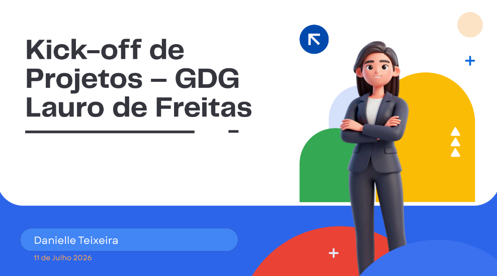
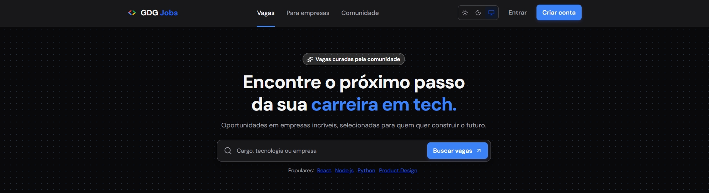

<p align="center">
  
</p>

<p align="center">
  <a href="https://github.com/rodrigochavesoa/gdg-lauro-de-freitas/actions/workflows/ci.yml">
    
  </a>
  <a href="https://www.conventionalcommits.org/pt-br/v1.0.0-beta.4/">
    
  </a>
  <br />
  
  
  
  
  
  
  <br />
  
  
</p>

# GDGJobs

Um laboratório de Engenharia de Produto para construir, testar e evoluir uma experiência de vagas curadas pela comunidade.

O GDGJobs aproxima profissionais de tecnologia de oportunidades relevantes. A experiência começa no catálogo, passa pelo detalhe da vaga e pela candidatura, e termina em uma curadoria responsável antes que uma vaga chegue ao público.

<p align="center">
  
</p>

## O problema que estamos resolvendo

Encontrar uma vaga relevante não deveria depender de navegar por fontes dispersas, interpretar informações inconsistentes ou confiar em publicações sem contexto. O projeto explora uma resposta comunitária para esse problema:

- reunir oportunidades em um catálogo simples;
- melhorar a qualidade por meio de curadoria;
- reduzir atrito entre descobrir uma vaga e candidatar-se;
- oferecer recomendações determinísticas e explicáveis com base nos critérios do catálogo.

## Como o produto funciona

```text
descobrir → entender → completar perfil → candidatar-se → acompanhar
                         ↑
                 curadoria da comunidade
```

Visitantes exploram vagas aprovadas, filtram o catálogo e consultam os detalhes. Candidatos autenticados completam o perfil, candidatam-se e acompanham o próprio histórico; também podem ativar recomendações por compatibilidade com critérios explícitos. A equipe staff recebe vagas, revisa o conteúdo e controla o que pode ser publicado.

## O que já foi construído

- catálogo público com busca, filtros, ordenação e paginação;
- detalhe da vaga e candidatura com estados claros de carregamento, erro e retry;
- login do candidato, onboarding, perfil e preferências;
- diretório comunitário de perfis compartilhados por opção do titular;
- recomendações determinísticas no catálogo, com razões de compatibilidade visíveis;
- curadoria com fila, prioridade, pareceres, rodadas e moderação;
- painel administrativo com próxima ação dinâmica para curadoria, ingestão e gestão de vagas;
- experiência responsiva, tema claro/escuro e acessibilidade em evolução;
- pipeline de qualidade com testes, build e validações antes do merge.

## Onde este projeto se encaixa

Este é um projeto paralelo de portfólio e aprendizado. Ele não é o produto oficial da comunidade e não substitui o [GDGJobs oficial](https://github.com/lfdev-gdg/GDGJobs), que continua sendo a referência do produto comunitário.

O paralelo usa a mesma inspiração de produto, mas mantém seu próprio ritmo, arquitetura e decisões de engenharia. O objetivo é aprender construindo uma experiência coerente e mensurável — não copiar outro repositório linha a linha.

## Como o produto evolui

**V1 — Catálogo curado**

Valor imediato: encontrar vagas, entender oportunidades, candidatar-se e garantir revisão comunitária.

**V2 — Contexto do candidato**

Perfis, preferências, descoberta comunitária e recomendações determinísticas fazem parte da experiência disponível. Fluxos de empresas e recrutadores continuam como evolução futura.

**V3 — Evolução da descoberta**

Explorar formas mais úteis e transparentes de aproximar profissionais e oportunidades, com validação gradual do produto.

## Comece pela documentação certa

- [**ABOUT.md**](ABOUT.md) — visão geral do produto e funcionalidades.
- [**SETUP.md**](SETUP.md) — como executar localmente.
- [**CONTRIBUTING.md**](CONTRIBUTING.md) — fluxo de trabalho, branches, PRs e critérios de entrega.
- [`docs/agents/`](docs/agents/) — mapa de contexto para agentes e ferramentas de engenharia.

## Desenvolvimento

Este é um projeto em evolução. Consulte o [ABOUT.md](ABOUT.md), siga o setup local e confirme mudanças com os mantenedores antes de alterar serviços externos.

## Licença e contato

Este repositório usa licença MIT. Consulte o [LICENSE](LICENSE) para o texto completo.

Para o contexto da comunidade GDG Lauro de Freitas, consulte o [repositório oficial GDGJobs](https://github.com/lfdev-gdg/GDGJobs). O contato público informado pelo projeto é [gdglaurodefreitas@gmail.com](mailto:gdglaurodefreitas@gmail.com).
